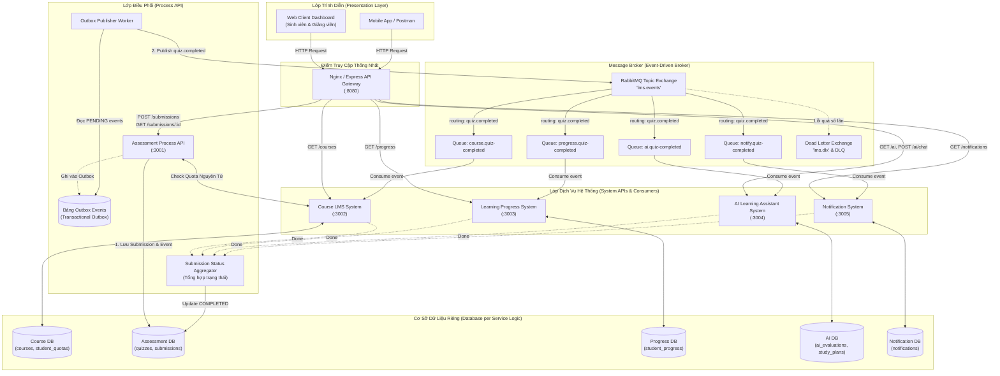
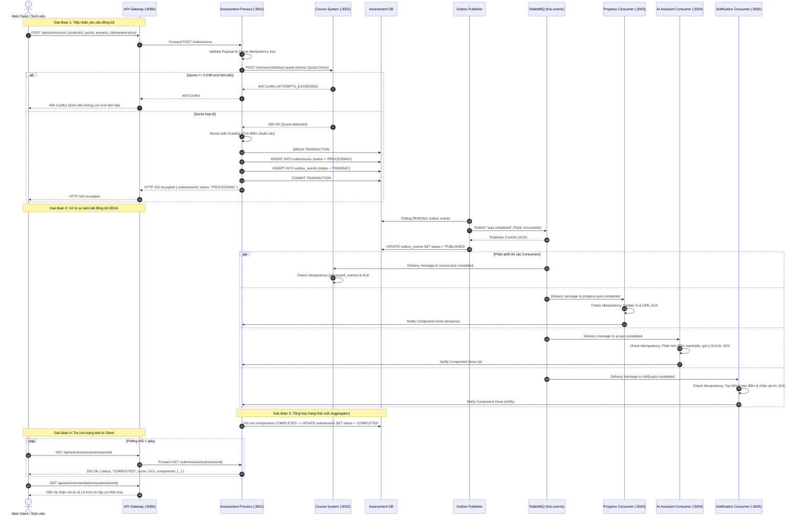
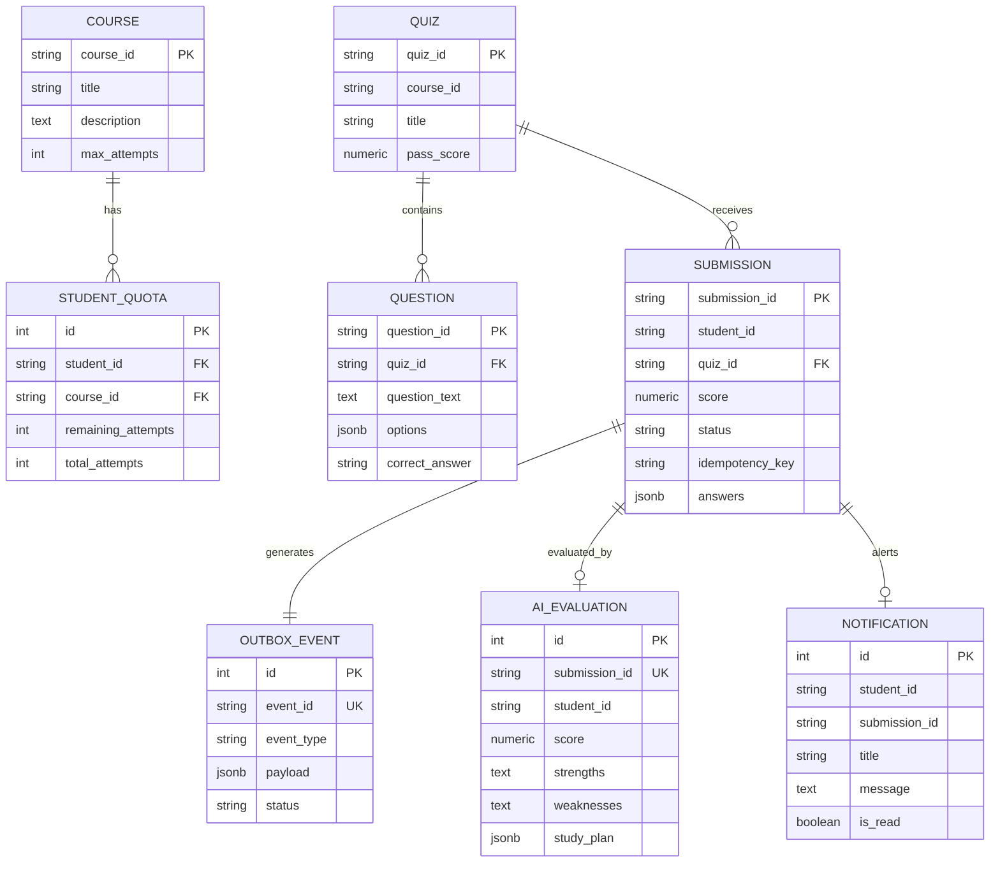

# SƠ ĐỒ HỆ THỐNG VÀ SEQUENCE DIAGRAM
**Đề tài:** Xây dựng và tích hợp hệ thống trợ lý học tập thông minh ứng dụng AI hỗ trợ sinh viên  
**Học phần:** Tích hợp hệ thống (SE445) - Đại học Duy Tân  
**Nhóm thực hiện:** Nhóm 13 (GVHD: ThS. Nguyễn Minh Nhật)  

---

## 1. Sơ đồ Kiến Trúc Tổng Thể (Overall Integration Architecture)

Hệ thống kết hợp giữa **Presentation Integration**, **API-led Connectivity** và **Event-Driven Architecture (EDA)** với mô hình **Transactional Outbox**:

---

## 2. Sequence Diagram: Luồng Nộp Bài Bất Đồng Bộ (Asynchronous Quiz Submission)

Biểu đồ tuần tự mô tả chi tiết từ lúc Client nộp bài, kiểm tra Quota nguyên tử, ghi nhận Transactional Outbox, trả HTTP 202 Accepted, đến khi RabbitMQ phân phối cho các Consumers và Status Aggregator hoàn tất trạng thái:

---

## 3. Sơ đồ Thực Thể Dữ Liệu (Entity Relationship & Database per Service)

